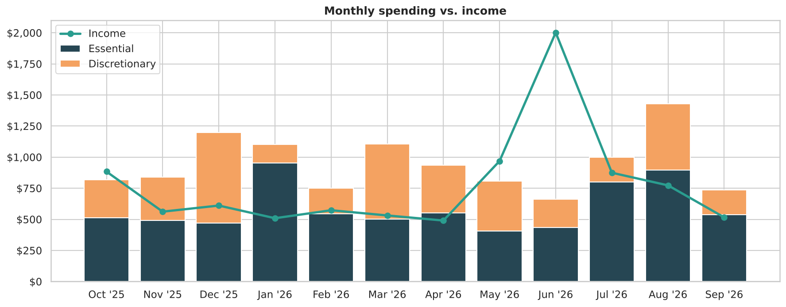
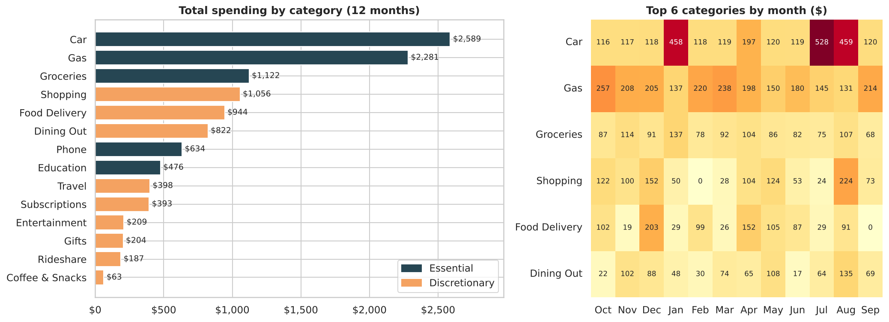
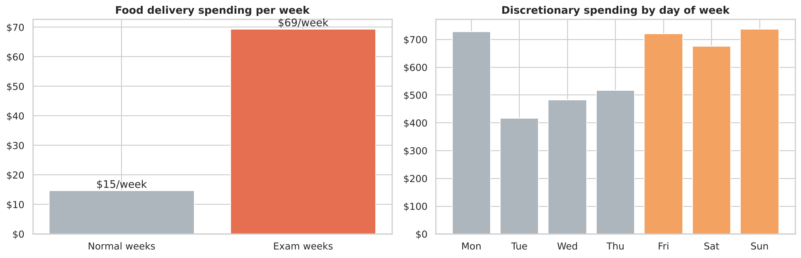
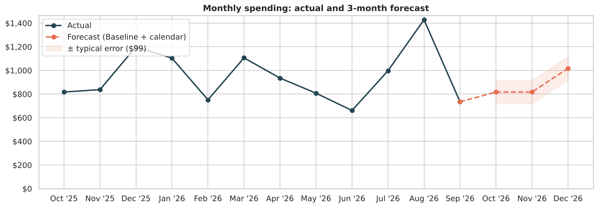
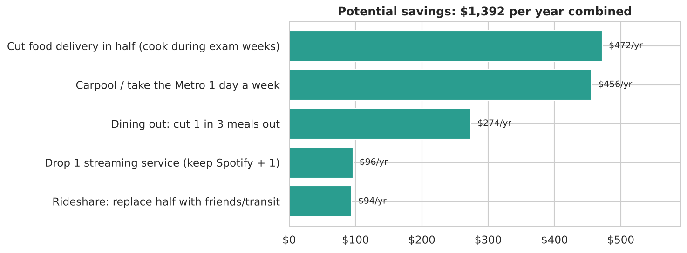

# Expense Tracker Analysis

A Python expense tracker that imports raw bank CSV exports, categorizes every transaction, stores it in SQLite, and powers an analysis notebook. The notebook shows where the money goes, flags unusual months, finds recurring charges, forecasts upcoming spending, and estimates how much realistic changes would save.

**Tools:** Python, pandas, SQLite, Matplotlib, Seaborn, Jupyter

> **About the data:** the analysis runs on **12 months of sample transactions** (`data/sample/`) generated to match a realistic college-student budget and a real bank's export format. It includes messy merchant names, biweekly paychecks, and semester costs. The tracker works the same way on real exports, as shown under [Use it on your own bank data](#use-it-on-your-own-bank-data).

---

## Key findings



- **Spending ($11,379) outran income ($9,294) by about $2,085.** 9 of 12 months ran a deficit, and summer income covered the school year.
- **Commuting is the biggest cost.** Car (insurance, repairs, parking permits) and gas make up **43% of all spending**.
- **Eating out cost 1.6x groceries:** $1,829 on delivery, restaurants, and coffee vs. $1,122 on groceries.
- **Food delivery jumps about 4.7x during exam weeks**, and Friday through Sunday account for half of discretionary spending.
- **Most spikes are predictable.** Semester starts, December gifts, spring break, and finals explain most month-over-month jumps.
- **Five realistic changes would save about $1,400/year**, cutting the annual shortfall by two-thirds.





## What the tracker does

| Feature | How it works |
|---|---|
| **Imports any major bank export** | Auto-detects Chase, Bank of America, and Capital One CSV layouts (including Capital One's split debit/credit columns) and normalizes them |
| **Categorizes automatically** | Keyword rules in [`config/categories.json`](config/categories.json) map messy descriptions (`UBER *EATS PENDING`, `TST* NANDOS PERI PERI`) to 14 categories in 4 groups: Income, Essential, Discretionary, Transfer. 100% of sample transactions categorized |
| **Never double-counts** | Transactions are stored in SQLite with a uniqueness constraint, so re-importing overlapping exports is safe |
| **Flags month-over-month jumps** | A category is flagged when it rises **≥30% and ≥$40**, which filters out noise from small categories |
| **Finds recurring charges** | Detects subscriptions and bills by looking for a repeated merchant with a 25-35 day cadence and stable amount, and flags ones that stopped |
| **Suggests a budget** | Median month for regular categories and a "sinking fund" (yearly total / 12) for lumpy ones like textbooks and travel |

```
$ python src/tracker.py summary --month 2026-03
       category         group  transactions  spent
         Travel Discretionary             2 398.40
            Gas     Essential             5 238.25
   ...
```

## Forecasting

With only 12 months of history, I compared simple, explainable methods using a **rolling backtest**: each of the last 6 months is forecast using only the months before it.

| Method | Mean absolute error |
|---|---|
| **Baseline + calendar** (normal month + known scheduled costs) | **$99 (~10% of a month)** |
| Historical average | $216 |
| Trailing 3-month average | $260 |
| Last month | $318 |

Most of the volatility comes from *scheduled* costs like semester starts and holidays, not randomness, so adding a simple calendar more than halves the error.



## Savings scenarios



## Use it on your own bank data

```bash
git clone https://github.com/riship1008/expense-tracker-analysis.git
cd expense-tracker-analysis
pip install -r requirements.txt

python src/tracker.py import ~/Downloads/your_bank_export.csv   # Chase, BofA, or Capital One
python src/tracker.py uncategorized    # see anything the rules missed, then add keywords to config/categories.json
python src/tracker.py summary --month 2026-09
python src/tracker.py budget
```

To run the full notebook on your data, point the import cell in `notebooks/expense_analysis.ipynb` at your file. Real exports stay local: `.gitignore` excludes the database and any CSV outside `data/sample/`.

## Project structure

```
expense-tracker-analysis/
├── config/categories.json          # categorization rules
├── data/sample/sample_bank_export.csv
├── notebooks/expense_analysis.ipynb
├── reports/figures/
└── src/
    ├── tracker.py                  # import, categorize, store, summarize (CLI)
    ├── analysis.py                 # MoM flags, recurring charges, backtesting
    └── generate_sample_data.py     # builds the sample dataset
```
