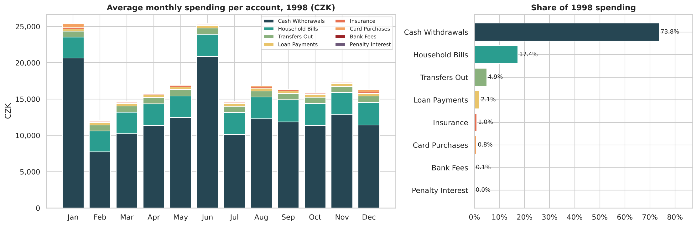
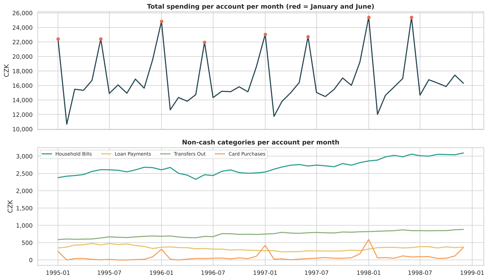
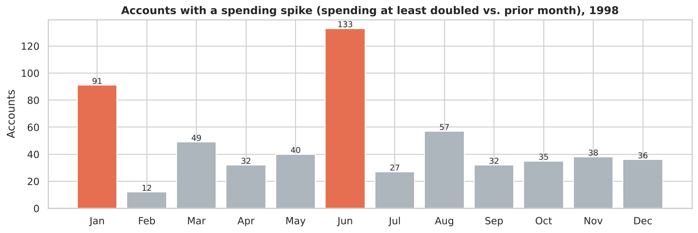
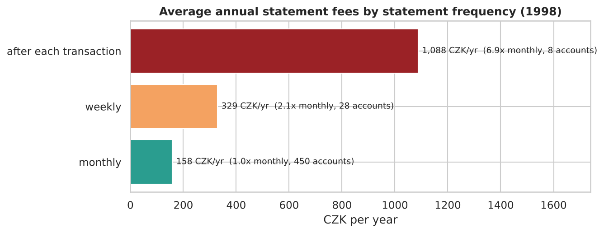
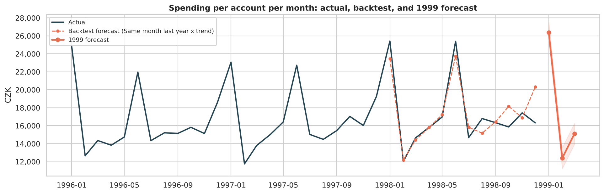

# Expense Tracker: Real Bank Transaction Analysis

A Python + SQLite expense tracker built on **real, anonymized bank data**. It translates and categorizes every transaction, tracks spending by category and month, flags spending spikes, finds avoidable fees, forecasts upcoming spending, and models savings scenarios.

**Tools:** Python, pandas, SQLite, statsmodels, Matplotlib, Seaborn, Jupyter

**Data:** the [Berka dataset](https://github.com/jlacko/berka-dataset): real transactions from a Czech bank, released (anonymized) for the PKDD'99 Discovery Challenge. This project uses a **random sample of 500 accounts (117,560 transactions, 1993–1998)**, with the main analysis on the **12 months of 1998 (35,911 transactions)**. Amounts are in Czech crowns (CZK); 1998 averaged about 32 CZK per US dollar.

---

## Key findings



- **100% of transactions categorized automatically.** The bank's Czech codes (`SIPO`, `SANKC. UROK`, `VYBER KARTOU`) are translated into 12 English categories in 5 groups: Income, Essential, Discretionary, Cash & Transfers, and Avoidable.
- **Cash dominated.** The average account spent **17,308 CZK/month (~$536)** in 1998: 74% as cash withdrawals, 17% on household bills, under 1% by card.
- **Spending is seasonal.** January and June run **53% above** other months, December card spending is **4.5x** a normal month, and household bills per account rose **18%** from 1995 to 1998.
- **60% of accounts had at least one spending spike** (spending doubled and rose 10,000+ CZK vs. the prior month), and **98% of spikes were driven by cash withdrawals**.
- **38% of accounts spent more than they took in** during 1998, and the median savings rate was just 2.4%.



## Month-over-month spike detection

Each account's monthly total is compared with the previous month. A spike requires **both** a ≥100% increase **and** ≥10,000 CZK, which filters out noise from small accounts.



## Avoidable costs

Statement fees depend on how often a customer gets statements: weekly costs **2.1x** monthly, and "after each transaction" costs **6.9x**. Accounts that go negative also pay penalty interest.



## Forecasting

Average spending per account per month is forecast with a **rolling backtest**: each month of 1998 is predicted using only earlier data, starting from 1995.

| Method | MAPE |
|---|---|
| **Same month last year x trend** | **6.6%** |
| Holt-Winters (trend + seasonality) | 7.2% |
| Same month last year | 7.6% |
| Trailing 3-month average | 21.9% |
| Last month | 25.7% |

Because spending is strongly seasonal, the seasonal methods cut error by about 4x compared with simple averages. The model predicts another January spike in 1999.



## Savings recommendations

| Recommendation | Accounts | Savings |
|---|---|---|
| Switch weekly / per-transaction statements to monthly | 36 | ~339 CZK per account per year |
| Keep a buffer to avoid negative balances (penalty interest) | 14 | ~209 CZK per account per year |
| Overspending accounts: cut cash withdrawals by 10% | 186 | Fully closes the 1998 shortfall for **57%** of them |

## Using the tracker

```bash
git clone https://github.com/riship1008/expense-tracker-analysis.git
cd expense-tracker-analysis
pip install -r requirements.txt

python src/download_data.py                          # download the raw bank files (~70 MB)
python src/tracker.py build                          # translate, categorize, store 500-account sample in SQLite
python src/tracker.py summary --account 2630 --year 1998   # one account's spending by month and category
python src/tracker.py flags --account 2630 --year 1998     # month-over-month increases by category
python src/tracker.py fees --year 1998                     # avoidable fees and penalty interest
```

```
$ python src/tracker.py summary --account 2630 --year 1998
category  Bank Fees  Cash Withdrawals    TOTAL
month
1998-01        15.0           41500.0  41515.0
1998-02        15.0           11200.0  11215.0
...
```

Use `--accounts 0` with `build` to load all 4,500 accounts (1M+ transactions).

## Project structure

```
expense-tracker-analysis/
├── config/categories.json            # Czech code translations + categorization rules
├── notebooks/bank_expense_analysis.ipynb
├── reports/figures/
└── src/
    ├── download_data.py              # fetches the Berka dataset
    ├── tracker.py                    # build SQLite DB, categorize, CLI summaries
    └── analysis.py                   # month-over-month flags, forecast backtesting
```

## Limitations
- This is 1990s data from one Czech bank, so patterns like heavy cash use reflect that market, not today's.
- Cash withdrawals and transfers carry no purpose code, so what that money bought can't be broken down further.
- Results come from a random 500-account sample (fixed seed) of the bank's 4,500 accounts.
